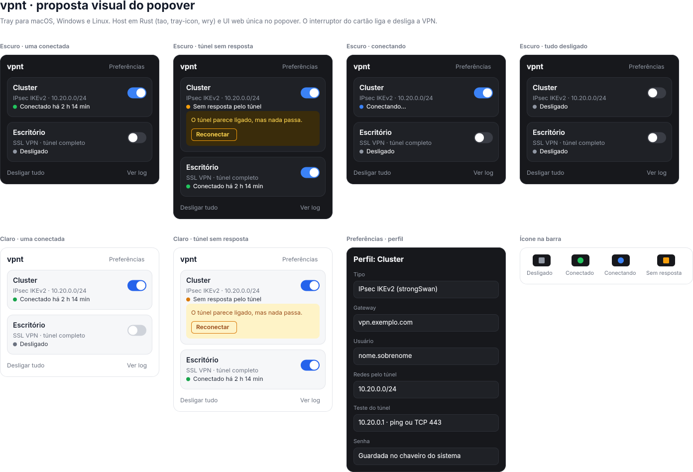

# vpnt

Ícone de bandeja (tray) para ligar, desligar e acompanhar VPNs no macOS, no
Windows e no Linux, com a mesma interface nos três.

> Estado: início do projeto. Ainda não há versão utilizável.

## Proposta

- **Host em Rust**, um binário único, com `tao` (laço de eventos), `tray-icon`
  (ícone na barra ou bandeja) e `wry` (webview nativa do sistema: WKWebView,
  WebView2 ou WebKitGTK).
- **Interface web única** no popover, igual nos três sistemas.
- **Perfis de VPN** configuráveis. Os primeiros tipos previstos são IPsec IKEv2
  (strongSwan) e SSL VPN da Fortinet (openfortivpn).
- **Estado real do túnel**: além de saber se o cliente está rodando, o vpnt
  testa se o tráfego passa. Um túnel que parece ligado mas não responde
  aparece como "sem resposta", com a opção de reconectar.
- **Segredos só no chaveiro do sistema**, nunca em arquivo nem em argumento de
  linha de comando.

## Proposta visual

O arquivo [`proto.fig`](proto.fig) abre no OpenPencil
e traz os estados do popover (conectado, conectando, sem resposta, desligado),
nos temas claro e escuro, a tela de perfil e os estados do ícone.



A fonte da proposta é `design/proto.html`. Para gerar o `.fig` de novo:

```bash
bunx @open-pencil/cli import design/proto.html -o proto.fig --pageName "Proposta"
```
